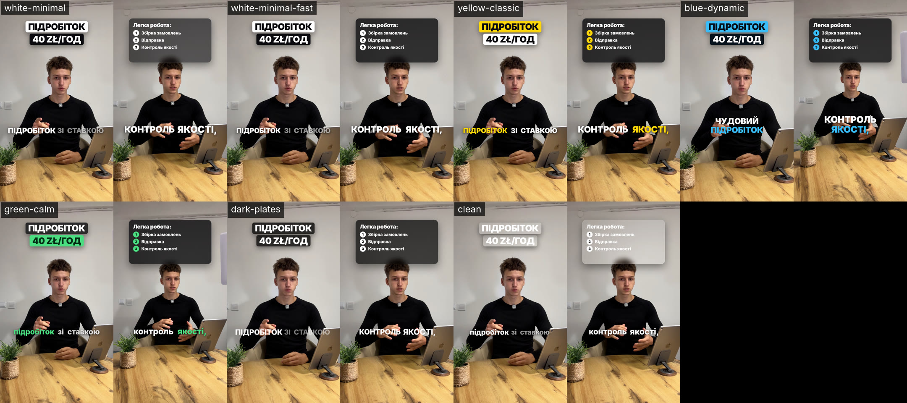
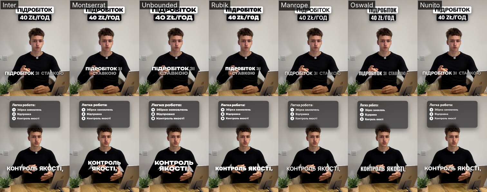

# HSS Shorts — личный монтаж Марка вместе с Claude

Инструмент, который превращает «грязное» видео с телефона в готовый ролик для Reels / TikTok /
Shorts: вырезает «ээ», паузы и дубли, выстраивает логику, добавляет субтитры, карточки, зумы и
звуки, выравнивает громкость и проверяет качество.

Подробно о том, как всё устроено и как расширять: [КАК-ЭТО-РАБОТАЕТ.md](КАК-ЭТО-РАБОТАЕТ.md)

## Как пользоваться

1. Сними видео и загрузи на Google Drive (доступ «Все, у кого есть ссылка» → Читатель),
   или положи в папку `01_Входящие/<формат>` на Диске, когда подключён коннектор Google Drive.
2. Открой **новый чат** с подключённым репозиторием `krollola90-ai/hss-shorts` и напиши **«монтаж»**.
3. Claude спросит формат и откуда взять видео → пришлёт превью или сразу готовый ролик.
4. Правки пиши обычными словами: «убери карточку на 20-й секунде», «верни фразу про жильё»,
   «сделай в жёлтом стиле».

Новый чат на каждое видео — так дешевле по лимиту. Всё нужное лежит здесь, в репозитории.

## Форматы

| Формат | Ключ | Статус | Стиль по умолчанию |
|---|---|---|---|
| Вакансия | `vacancy` | ✅ проверен на 5 видео | Белый минимал · быстрый |
| Мысль | `thought` | черновик | Спокойный · зелёный |
| Идея | `idea` | черновик | Классика · жёлтый |
| Влог | `vlog` | черновик | Спокойный · зелёный |
| Эдит (под бит) | `edit` | черновик | Динамика · голубой |

Черновой формат при первом видео: Claude покажет 3 стиля на твоих кадрах, выбранный сохранится.

## Стили



Подробно: [`shorts-editor/docs/styles.md`](shorts-editor/docs/styles.md). Шрифты на выбор:
Inter, Montserrat, Unbounded, Rubik, Manrope, Oswald, Nunito (все с кириллицей).



## Что где лежит

```
.claude/skills/montazh/        меню «монтаж»
.claude/skills/shorts-editor/  инструкция монтажа для Claude
shorts-editor/
  shorts                       команды монтажа (запусти без аргументов — покажет список)
  setup.sh                     установка программ (сама запускается в новом чате)
  formats/                     шаблоны форматов: структура, длина, стиль, концовка
  styles/                      стили: цвета, шрифт, субтитры, темп, зумы
  assets/sfx/                  звуки (28 шт.) + manifest.json
  assets/music/<настроение>/   музыка — добавляешь сам (calm, upbeat, emotional, phonk, lofi)
  assets/fonts/                шрифты
  projects/<формат-дата-тема>/ каждое видео: план монтажа, вырезки, стиль
  footage/edited/              готовые ролики
  docs/                        каталог стилей и картинки
```

## Чего не хватает (добавляешь ты)

- **Музыка**: 10–15 треков с Pixabay Music или YouTube Audio Library → `assets/music/<настроение>/`,
  строку в `assets/music/CREDITS.md`.
- **Коннектор Google Drive** в настройках Claude — чтобы брать видео из папок без ссылок.
