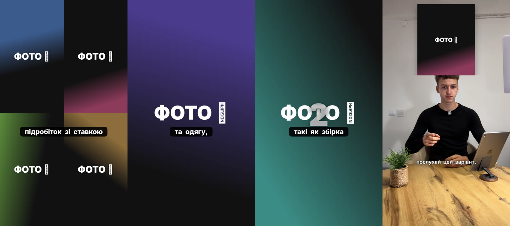

# Референсы — что нравится Марку

Каждый референс: что сказал Марк (его слова) + разбор приёмов + что из этого сделано в системе.
Сами видео лежат на Google Диске: `HSS Content/_Библиотека/Референсы`.

---

## 1. «Девушка qlevel» — вакансия, TikTok @q.level.group (29.10.2026)

**Марк:** «Максимально понравились субтитры, очень хорошие. И смайлики — визуальное восприятие:
она говорит о деньгах — смайлик денег, о машине — смайлик машины. Красиво выглядит, хочу это
использовать как шаблон».

**Разбор приёмов**
- **Субтитры**: узкий («кондесированный») шрифт капсом, белый с мягкой тенью, 3–5 слов, по центру
  на уровне груди. **Текущее слово — на фиолетовой плашке** (#6B21F2), остальные белые.
- **Эмодзи на ключевых словах**: одно крупное эмодзи **по центру над головой**, появляется ровно
  на слове (деньги 💵, поезд 🚆, автобус 🚌, самолёт ✈️, люди 👥, дом 🏠, документы 📁), держится
  ~1,5–2 с. Иногда вместо эмодзи — мем-стикер (кот с деньгами, кот с телефоном на призыве).
- **Заголовок сверху** первые секунды: белый жирный текст с тенью + эмодзи рядом
  («WE REIMBURSE YOU FOR YOUR TICKETS 💸✈️»), появляется «кликом» курсора.
- **Цифра зарплаты**: крупная зелёная «35,40 zł 💰», набегает счётчиком.
- **Темп**: речь без пауз, джамп-каты, редкий «рывок» зума и вставка-коллаж (человек на
  полутоновом фоне) как переход.
- Карточек-плашек нет: вся информация — субтитры + эмодзи + цифра.

**Что сделано**
- Стиль **`styles/emoji-story.json`** «Эмодзи-история»: шрифт Oswald (узкий), активное слово на
  фиолетовой плашке, заголовок без плашек с эмодзи, зелёные цифры со счётчиком (`"countup": true`).
- **Авто-эмодзи по ключевым словам** (`assets/emoji-keywords.json`, укр/рус): деньги, жильё,
  транспорт, склад, одежда, договор, график, люди, опыт, перерыв, контакты… — эмодзи по центру
  над головой ровно на слове. Словарь можно пополнять.
- Пример: 

**Ещё не сделано (в план)**: мем-стикеры (нужны файлы от Марка в `_Библиотека/Стикеры и эмодзи`),
появление заголовка «кликом» курсора, переход-коллаж на полутоновом фоне.

---

## 2. MM1 — мотивация-рассказ «альтер эго», TikTok @alexey_lisicyn (29.10.2026)

**Марк:** «MM1 и MM2 — это мысли и мотивация в одном. В таком формате я буду делать свои видео,
выкладывать свои мысли. Запомни формат и превращай мои мысли в подобный, только по-моему».

**Разбор приёмов**
- **Хук**: первая секунда — **коллаж 2×2** из четырёх известных людей, сразу интрига.
- **Говорящий в кадре только на связках** (~40% времени). Остальное — **фото на весь экран**,
  которые меняются каждые 1,5–3 с ровно на существительном: человек в молодости → его образ →
  афиша; кадры из фильмов как мем-иллюстрация; **скриншот статьи/исследования** как доказательство.
- **Шаги 1/2/3** — огромная серая цифра поверх кинематографичной картинки.
- **Субтитры**: маленькие, обычный регистр (не капс), белые на **чёрной плашке**, по центру.
- ~27 смен кадра за 70 с. Концовка — строка поиска TikTok с ником автора.

**Что сделано** — формат `formats/motivation.json`, вариант **doc**, стиль `styles/doc-story.json`:
коллаж `grid`, фото `image` с `layout: full`, цифры шагов (`"number": 2`), субтитры на чёрной плашке.

## 3. MM2 — мысль с картинкой над головой (29.10.2026)

**Разбор приёмов**
- Говорящий **в кадре всё время**, спокойный темп.
- **Панель-иллюстрация сверху** (верхняя треть, над головой) меняется каждые 3–5 с:
  скульптура «Мыслитель», комната, озеро, анатомия мозга, сюрреалистичные винтажные коллажи,
  ч/б фото, картины — **образ к мысли, а не буквальная картинка**.
- Субтитры мелкие, белые, обычный регистр, внизу; почти без зумов.

**Что сделано** — вариант **panel**, стиль `styles/mind-panel.json`, фото `image` с `layout: top`.

Пример обеих раскладок (на заглушках): 
— коллаж-хук · фото на весь экран · цифра шага · панель над головой.

**Ещё не сделано**: концовка «строка поиска TikTok с ником», тонкая настройка высоты панели под
кадр Марка (на первом реальном видео).
