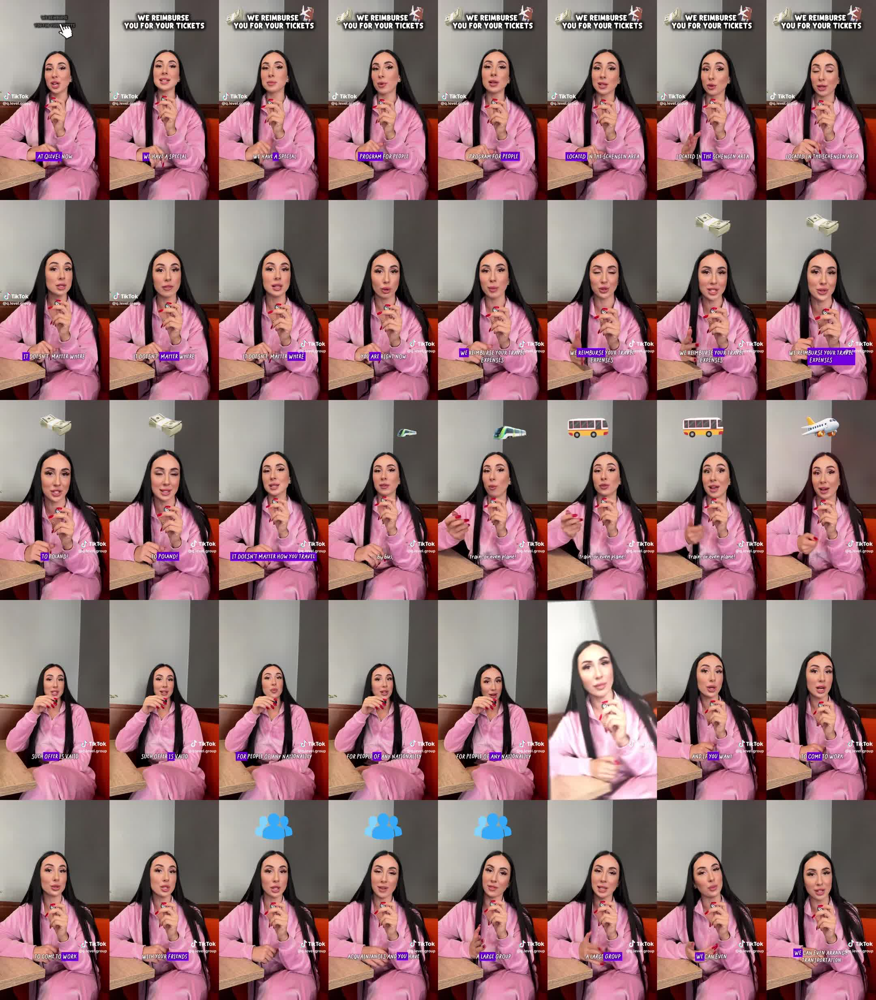
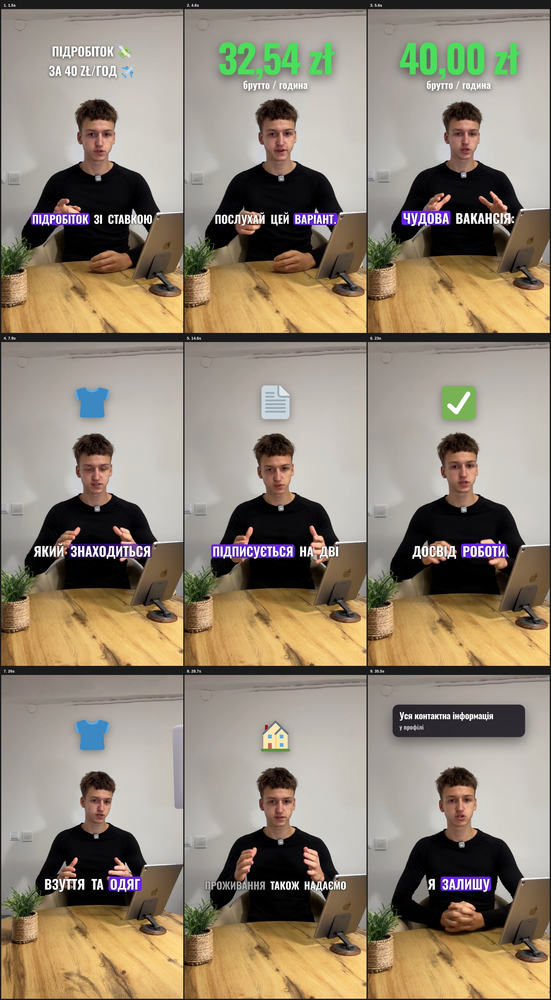

# Референсы — что нравится Марку

Каждый референс: что сказал Марк (его слова) + разбор приёмов + что из этого сделано в системе.
Сами видео лежат на Google Диске: `HSS Content/_Библиотека/Референсы`.

---

## 1. «Девушка qlevel» — вакансия, TikTok @q.level.group (29.10.2026)

**Марк:** «Максимально понравились субтитры, очень хорошие. И смайлики — визуальное восприятие:
она говорит о деньгах — смайлик денег, о машине — смайлик машины. Красиво выглядит, хочу это
использовать как шаблон».

**Разбор приёмов**
- **Субтитры**: узкий («кондесированный») шрифт капсом, белый с мягкой тенью, 3–5 слов, по центру
  на уровне груди. **Текущее слово — на фиолетовой плашке** (#6B21F2), остальные белые.
- **Эмодзи на ключевых словах**: одно крупное эмодзи **по центру над головой**, появляется ровно
  на слове (деньги 💵, поезд 🚆, автобус 🚌, самолёт ✈️, люди 👥, дом 🏠, документы 📁), держится
  ~1,5–2 с. Иногда вместо эмодзи — мем-стикер (кот с деньгами, кот с телефоном на призыве).
- **Заголовок сверху** первые секунды: белый жирный текст с тенью + эмодзи рядом
  («WE REIMBURSE YOU FOR YOUR TICKETS 💸✈️»), появляется «кликом» курсора.
- **Цифра зарплаты**: крупная зелёная «35,40 zł 💰», набегает счётчиком.
- **Темп**: речь без пауз, джамп-каты, редкий «рывок» зума и вставка-коллаж (человек на
  полутоновом фоне) как переход.
- Карточек-плашек нет: вся информация — субтитры + эмодзи + цифра.

**Что сделано**
- Стиль **`styles/emoji-story.json`** «Эмодзи-история»: шрифт Oswald (узкий), активное слово на
  фиолетовой плашке, заголовок без плашек с эмодзи, зелёные цифры со счётчиком (`"countup": true`).
- **Авто-эмодзи по ключевым словам** (`assets/emoji-keywords.json`, укр/рус): деньги, жильё,
  транспорт, склад, одежда, договор, график, люди, опыт, перерыв, контакты… — эмодзи по центру
  над головой ровно на слове. Словарь можно пополнять.
- Пример: 

**Ещё не сделано (в план)**: мем-стикеры (нужны файлы от Марка в `_Библиотека/Стикеры и эмодзи`),
появление заголовка «кликом» курсора, переход-коллаж на полутоновом фоне.
